# UML Class Diagram – Lab 08: Delegate & Event

> Sơ đồ mô tả **đúng bản code C# hiện tại (7 file)**. Không yêu cầu thay đổi code.

## 1. Sơ đồ lớp

```mermaid
classDiagram
    direction TB

    class DeviceStatus {
        <<enumeration>>
        Available
        Borrowed
        UnderMaintenance
    }
    class AlertSeverity {
        <<enumeration>>
        Information
        Warning
        Critical
    }

    class DeviceStatusChangedEventArgs {
        +string DeviceId
        +DeviceStatus OldStatus
        +DeviceStatus NewStatus
        +DateTime ChangedAt
    }
    class DeviceAlertEventArgs {
        +string DeviceId
        +string Message
        +AlertSeverity Severity
        +DateTime OccurredAt
    }
    class EventArgs {
        <<.NET framework>>
    }

    class TeachingDevice {
        <<abstract>>
        +string Id
        +string Name
        +DeviceStatus Status
        +EventHandler~DeviceStatusChangedEventArgs~ StatusChanged
        +EventHandler~DeviceAlertEventArgs~ AlertRaised
        +ChangeStatus(DeviceStatus newStatus) void
        #RaiseAlert(string message, AlertSeverity severity) void
        #OnStatusChanged(DeviceStatusChangedEventArgs e) void
        #OnAlertRaised(DeviceAlertEventArgs e) void
    }
    class ProjectorRemote {
        +int BatteryLevel
        +UpdateBatteryLevel(int newLevel) void
    }
    class AirConditionerRemote {
        +string AssignedRoom
        +bool IsResponsive
        +UpdateResponseState(bool isResponsive) void
    }
    class WirelessMicrophone {
        +int BatteryLevel
        +int SignalQuality
        +UpdateBatteryLevel(int newLevel) void
        +UpdateSignalQuality(int newQuality) void
    }
    class InvalidDeviceReadingException {
        +string DeviceId
        +int InvalidValue
    }
    class Exception {
        <<.NET framework>>
    }

    class ConsoleNotificationService {
        +HandleAlert(object sender, DeviceAlertEventArgs e) void
    }
    class DeviceAuditLogger {
        -List~string~ entries
        +IReadOnlyList~string~ Entries
        +HandleStatusChanged(object sender, DeviceStatusChangedEventArgs e) void
    }
    class MaintenanceService {
        -List~string~ requests
        +IReadOnlyList~string~ Requests
        +HandleCriticalAlert(object sender, DeviceAlertEventArgs e) void
    }
    class AlertFilter {
        <<delegate>>
        +bool Invoke(DeviceAlertEventArgs alert)
    }
    class FilteredAlertSubscriber {
        -AlertFilter filter
        -Action~DeviceAlertEventArgs~ action
        +HandleAlert(object sender, DeviceAlertEventArgs e) void
    }
    class DeviceMonitoringCoordinator {
        -List~TeachingDevice~ devices
        -ConsoleNotificationService notificationService
        -DeviceAuditLogger auditLogger
        -MaintenanceService maintenanceService
        -FilteredAlertSubscriber filteredSubscriber
        -bool subscribed
        +Subscribe() void
        +Unsubscribe() void
        +Dispose() void
    }
    class IDisposable {
        <<interface>>
        +Dispose() void
    }
    class Program {
        -Main() void
    }

    EventArgs <|-- DeviceStatusChangedEventArgs
    EventArgs <|-- DeviceAlertEventArgs
    Exception <|-- InvalidDeviceReadingException

    TeachingDevice <|-- ProjectorRemote
    TeachingDevice <|-- AirConditionerRemote
    TeachingDevice <|-- WirelessMicrophone
    TeachingDevice ..> DeviceStatus : uses
    TeachingDevice ..> DeviceStatusChangedEventArgs : publishes
    TeachingDevice ..> DeviceAlertEventArgs : publishes
    DeviceStatusChangedEventArgs ..> DeviceStatus : uses
    DeviceAlertEventArgs ..> AlertSeverity : uses

    ProjectorRemote ..> InvalidDeviceReadingException : throws
    WirelessMicrophone ..> InvalidDeviceReadingException : throws

    ConsoleNotificationService ..> DeviceAlertEventArgs : handles
    MaintenanceService ..> DeviceAlertEventArgs : handles
    DeviceAuditLogger ..> DeviceStatusChangedEventArgs : handles
    AlertFilter ..> DeviceAlertEventArgs : checks
    FilteredAlertSubscriber --> AlertFilter : uses
    FilteredAlertSubscriber ..> DeviceAlertEventArgs : handles

    DeviceMonitoringCoordinator ..|> IDisposable
    DeviceMonitoringCoordinator "1" o-- "0..*" TeachingDevice : monitors
    DeviceMonitoringCoordinator --> ConsoleNotificationService : subscribes
    DeviceMonitoringCoordinator --> DeviceAuditLogger : subscribes
    DeviceMonitoringCoordinator --> MaintenanceService : subscribes
    DeviceMonitoringCoordinator --> FilteredAlertSubscriber : optional
    Program ..> DeviceMonitoringCoordinator : creates
```

Nếu GitHub không hiển thị sơ đồ, bạn có thể mở [ảnh SVG](./UML.svg) hoặc [ảnh PNG](./UML.png).

## 2. Các mối quan hệ chính

- **Kế thừa:** `ProjectorRemote`, `AirConditionerRemote`, `WirelessMicrophone` kế thừa lớp trừu tượng `TeachingDevice`.
- **Dữ liệu sự kiện:** `DeviceStatusChangedEventArgs` và `DeviceAlertEventArgs` kế thừa `EventArgs`.
- **Publisher:** `TeachingDevice` công bố hai event `StatusChanged` và `AlertRaised`.
- **Subscribers:** `DeviceAuditLogger` nhận thay đổi trạng thái; `ConsoleNotificationService`, `MaintenanceService`, `FilteredAlertSubscriber` nhận cảnh báo.
- **Điều phối:** `DeviceMonitoringCoordinator` giữ danh sách thiết bị, đăng ký/hủy event và triển khai `IDisposable`.
- **Lọc sự kiện:** `FilteredAlertSubscriber` dùng delegate `AlertFilter` và `Action<DeviceAlertEventArgs>`.
- **Ngoại lệ:** `ProjectorRemote` và `WirelessMicrophone` có thể phát sinh `InvalidDeviceReadingException` khi giá trị đo ngoài 0–100.

**Chú thích UML:** `+` public, `-` private, `#` protected, mũi tên tam giác rỗng là kế thừa/triển khai, đường nét đứt là phụ thuộc, hình thoi rỗng là kết tập (aggregation). Các lớp `EventArgs`, `Exception`, `IDisposable` thuộc .NET, không nằm trong 7 file tự viết. `AlertFilter` là delegate; phương thức `Invoke` trong sơ đồ biểu diễn chữ ký của delegate, không phải phương thức bạn tự khai báo trong code.

## 3. Các file mã nguồn tương ứng

| File C# | Thành phần trong sơ đồ |
|---|---|
| `Enums.cs` | `DeviceStatus`, `AlertSeverity` |
| `DeviceEventArgs.cs` | `DeviceStatusChangedEventArgs`, `DeviceAlertEventArgs` |
| `TeachingDevice.cs` | `TeachingDevice` |
| `Devices.cs` | Ba thiết bị và `InvalidDeviceReadingException` |
| `Services.cs` | Bốn service/subscriber và `AlertFilter` |
| `DeviceMonitoringCoordinator.cs` | `DeviceMonitoringCoordinator` |
| `Program.cs` | `Program` |

*Ghi chú:* Các thuộc tính trong UML được trình bày rút gọn về getter/setter để sơ đồ dễ đọc; mã nguồn hiện tại vẫn là tài liệu tham chiếu chính.
