# UML Class Diagram — Lab 08: Delegate & Event

**Phiên bản:** C# sau khi cải tiến, gồm 7 file `.cs` (kết quả chạy do sinh viên cung cấp: **22 PASS / 0 FAIL**). Sơ đồ được đối chiếu với mã nguồn, không thay đổi mã nguồn.

## 1. Biểu đồ lớp UML

GitHub hỗ trợ hiển thị sơ đồ sau trực tiếp từ `UML.md`:

```mermaid
classDiagram
    direction TB

    class TeachingDevice {
        <<abstract>>
        +string Id
        +string Name
        +DeviceStatus Status
        +EventHandler~DeviceStatusChangedEventArgs~ StatusChanged
        +EventHandler~DeviceAlertEventArgs~ AlertRaised
        +ChangeStatus(DeviceStatus newStatus) void
        #RaiseAlert(string message, AlertSeverity severity) void
        #OnStatusChanged(DeviceStatusChangedEventArgs e) void
        #OnAlertRaised(DeviceAlertEventArgs e) void
    }
    class ProjectorRemote {
        -int LowBatteryThreshold
        +int BatteryLevel
        +UpdateBatteryLevel(int newLevel) void
    }
    class AirConditionerRemote {
        +string AssignedRoom
        +bool IsResponsive
        +UpdateResponseState(bool isResponsive) void
    }
    class WirelessMicrophone {
        -int LowBatteryThreshold
        -int LowSignalThreshold
        +int BatteryLevel
        +int SignalQuality
        +UpdateBatteryLevel(int newLevel) void
        +UpdateSignalQuality(int newQuality) void
    }
    class DeviceReadingRules {
        <<utility>>
        +Validate(string deviceId, int value) void
        +GetSeverity(int value, int threshold) AlertSeverity
        +BecameMoreSevere(int oldValue, int newValue, int threshold) bool
    }
    class InvalidDeviceReadingException {
        +string DeviceId
        +int InvalidValue
    }

    class DeviceStatus {
        <<enumeration>>
        Available
        Borrowed
        UnderMaintenance
    }
    class AlertSeverity {
        <<enumeration>>
        Information
        Warning
        Critical
    }
    class DeviceStatusChangedEventArgs {
        +string DeviceId
        +DeviceStatus OldStatus
        +DeviceStatus NewStatus
        +DateTime ChangedAt
    }
    class DeviceAlertEventArgs {
        +string DeviceId
        +string Message
        +AlertSeverity Severity
        +DateTime OccurredAt
    }

    class ConsoleNotificationService {
        +HandleAlert(object sender, DeviceAlertEventArgs e) void
    }
    class DeviceAuditLogger {
        -List~string~ entries
        +IReadOnlyList~string~ Entries
        +HandleStatusChanged(object sender, DeviceStatusChangedEventArgs e) void
    }
    class MaintenanceService {
        -List~string~ requests
        +IReadOnlyList~string~ Requests
        +HandleCriticalAlert(object sender, DeviceAlertEventArgs e) void
    }
    class AlertFilter {
        <<delegate>>
        +Invoke(DeviceAlertEventArgs alert) bool
    }
    class FilteredAlertSubscriber {
        -AlertFilter filter
        -Action~DeviceAlertEventArgs~ action
        +HandleAlert(object sender, DeviceAlertEventArgs e) void
    }
    class DeviceMonitoringCoordinator {
        -List~TeachingDevice~ devices
        -ConsoleNotificationService notificationService
        -DeviceAuditLogger auditLogger
        -MaintenanceService maintenanceService
        -FilteredAlertSubscriber filteredSubscriber
        -bool subscribed
        -bool disposed
        +Subscribe() void
        +Unsubscribe() void
        +Dispose() void
    }
    class Program {
        -Main() void
        -RunDemo() void
        -RunTests() void
    }
    class EventArgs {
        <<.NET>>
    }
    class Exception {
        <<.NET>>
    }
    class IDisposable {
        <<interface>>
        +Dispose() void
    }

    TeachingDevice <|-- ProjectorRemote
    TeachingDevice <|-- AirConditionerRemote
    TeachingDevice <|-- WirelessMicrophone
    EventArgs <|-- DeviceStatusChangedEventArgs
    EventArgs <|-- DeviceAlertEventArgs
    Exception <|-- InvalidDeviceReadingException
    IDisposable <|.. DeviceMonitoringCoordinator

    TeachingDevice ..> DeviceStatus : state
    TeachingDevice ..> DeviceStatusChangedEventArgs : StatusChanged
    TeachingDevice ..> DeviceAlertEventArgs : AlertRaised
    DeviceStatusChangedEventArgs ..> DeviceStatus
    DeviceAlertEventArgs ..> AlertSeverity
    ProjectorRemote ..> DeviceReadingRules : uses
    WirelessMicrophone ..> DeviceReadingRules : uses
    DeviceReadingRules ..> InvalidDeviceReadingException : throws
    DeviceReadingRules ..> AlertSeverity : returns

    DeviceMonitoringCoordinator "1" o-- "0..*" TeachingDevice : monitors
    DeviceMonitoringCoordinator --> ConsoleNotificationService : subscribes
    DeviceMonitoringCoordinator --> MaintenanceService : subscribes
    DeviceMonitoringCoordinator --> DeviceAuditLogger : subscribes
    DeviceMonitoringCoordinator --> FilteredAlertSubscriber : optional
    FilteredAlertSubscriber --> AlertFilter : uses

    ConsoleNotificationService ..> DeviceAlertEventArgs : handles
    MaintenanceService ..> DeviceAlertEventArgs : handles
    DeviceAuditLogger ..> DeviceStatusChangedEventArgs : handles
    FilteredAlertSubscriber ..> DeviceAlertEventArgs : handles
    Program ..> DeviceMonitoringCoordinator : creates
```

Nếu không xem được Mermaid, mở [ảnh UML.png](./UML.png).

## 2. Giải thích thiết kế

- **Kế thừa:** Ba lớp `ProjectorRemote`, `AirConditionerRemote`, `WirelessMicrophone` kế thừa lớp trừu tượng `TeachingDevice`.
- **Publisher:** `TeachingDevice` công bố hai sự kiện `StatusChanged` và `AlertRaised`; các lớp thiết bị không gọi trực tiếp service.
- **Payload:** Hai lớp `DeviceStatusChangedEventArgs` và `DeviceAlertEventArgs` kế thừa `EventArgs`.
- **Subscriber:** `DeviceAuditLogger` nhận thay đổi trạng thái; `ConsoleNotificationService`, `MaintenanceService` và `FilteredAlertSubscriber` xử lý cảnh báo.
- **Delegate:** `AlertFilter` có chữ ký `bool(DeviceAlertEventArgs)`; `FilteredAlertSubscriber` dùng delegate cùng với `Action<DeviceAlertEventArgs>`.
- **Điều phối:** `DeviceMonitoringCoordinator` giữ các tham chiếu tới thiết bị và service, quản lý `Subscribe`, `Unsubscribe`; triển khai `IDisposable` và sử dụng hai cờ `subscribed`, `disposed`.
- **Quy tắc đo:** `DeviceReadingRules` là `internal static class`, kiểm tra giá trị trong **[0, 100]**, phân loại mức cảnh báo và chỉ báo khi chuyển sang vùng nghiêm trọng hơn. Giá trị sai phát sinh `InvalidDeviceReadingException`.

### Ngưỡng cảnh báo

| Thiết bị | Mức Warning | Mức Critical |
|---|---|---|
| ProjectorRemote | 1–19% pin | 0% pin |
| WirelessMicrophone (pin) | 1–29% pin | 0% pin |
| WirelessMicrophone (tín hiệu) | 1–39% tín hiệu | 0% tín hiệu |
| AirConditionerRemote | — | Chuyển từ phản hồi sang không phản hồi |

`Information` biểu thị vùng an toàn của các giá trị đo. Code hiện tại không phát event thông báo phục hồi khi mức nghiêm trọng giảm.

## 3. Ánh xạ UML với 7 file C#

| File | Các thành phần |
|---|---|
| `Enums.cs` | `DeviceStatus`, `AlertSeverity` |
| `DeviceEventArgs.cs` | `DeviceStatusChangedEventArgs`, `DeviceAlertEventArgs` |
| `TeachingDevice.cs` | `TeachingDevice` |
| `Devices.cs` | `ProjectorRemote`, `AirConditionerRemote`, `WirelessMicrophone`, `DeviceReadingRules`, `InvalidDeviceReadingException` |
| `Services.cs` | `ConsoleNotificationService`, `DeviceAuditLogger`, `MaintenanceService`, `FilteredAlertSubscriber`, `AlertFilter` |
| `DeviceMonitoringCoordinator.cs` | `DeviceMonitoringCoordinator` |
| `Program.cs` | `Program` (demo và 22 kiểm thử) |

## 4. Ký hiệu UML

- `+` public, `-` private, `#` protected.
- Mũi tên tam giác rỗng liền nét: **kế thừa**; nét đứt: **triển khai interface**.
- Đường nét đứt có mũi tên: **phụ thuộc / sử dụng**.
- Hình thoi rỗng: **aggregation (kết tập)**; coordinator giữ danh sách thiết bị nhưng không sở hữu vòng đời của chúng.
- `EventArgs`, `Exception`, `IDisposable` là các kiểu có sẵn của .NET, không phải lớp tự tạo trong project.
- `AlertFilter.Invoke` thể hiện chữ ký do C# sinh cho delegate, không phải phương thức do sinh viên viết thủ công.

> Ghi chú: Sơ đồ tập trung các thành viên và quan hệ phục vụ yêu cầu bài Lab; constructor, getter/setter và các chi tiết của .NET được lược bớt để dễ đọc.
